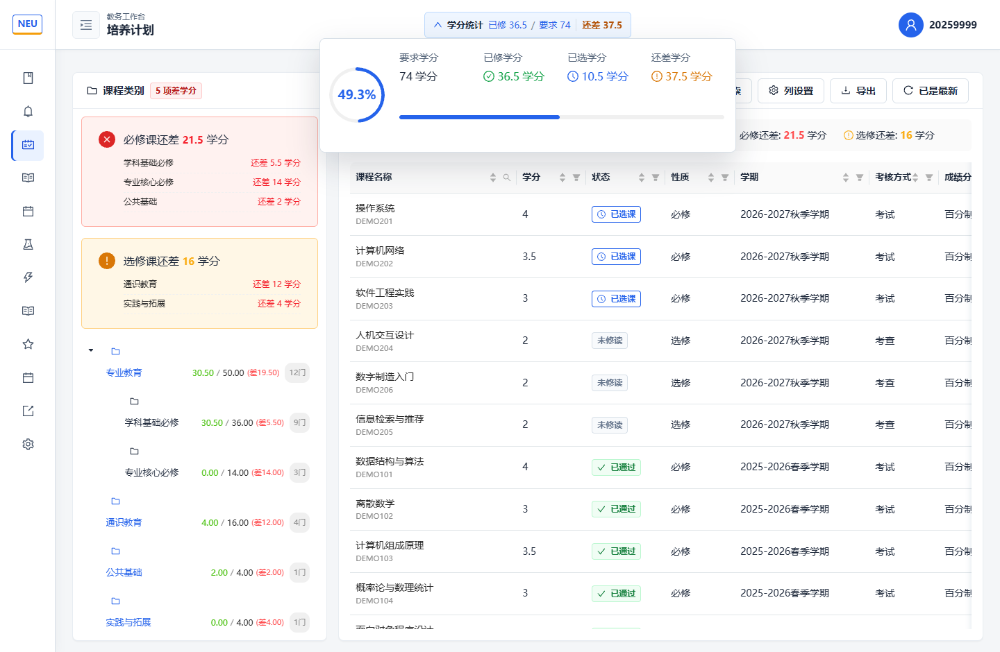
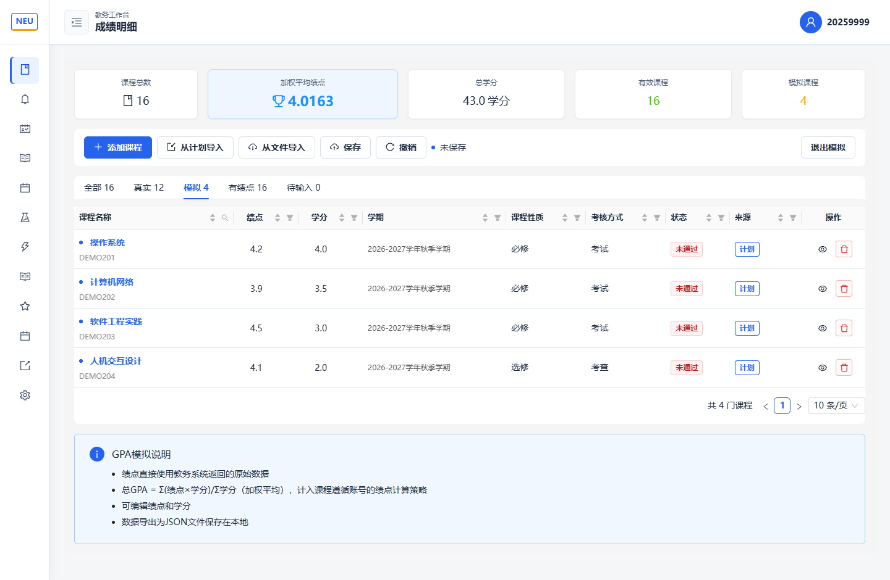
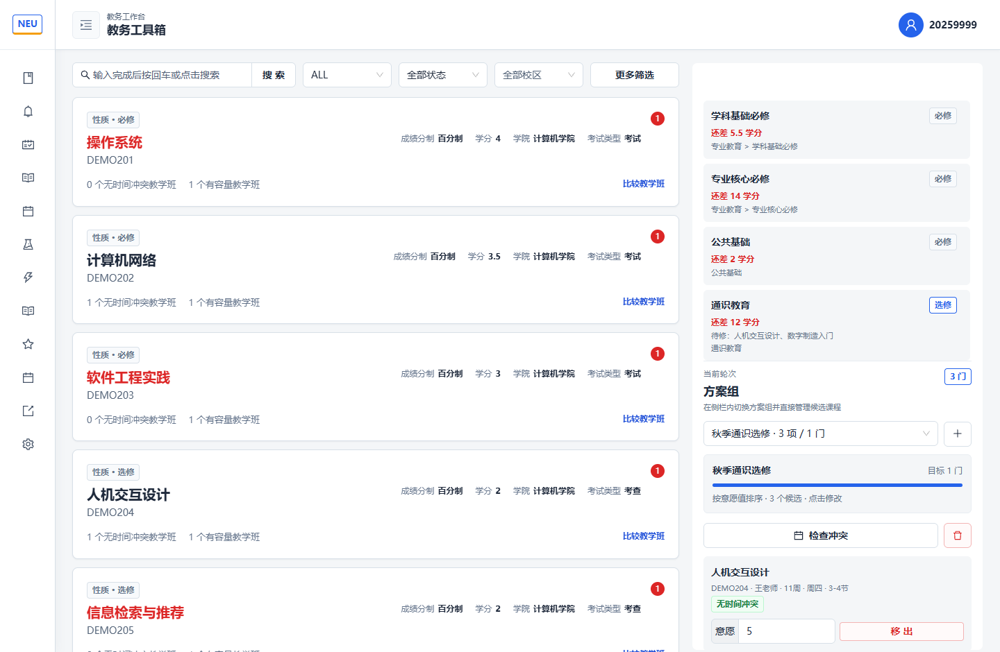
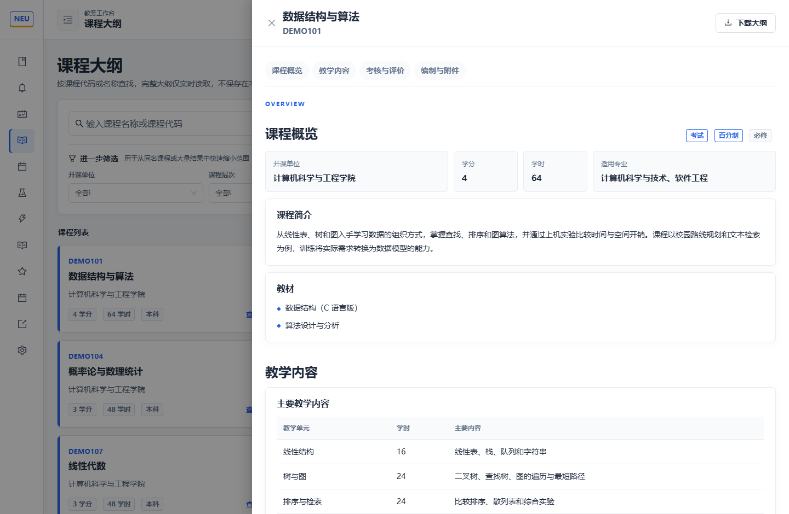

<p align="center"></p>

# NEU 教务系统工具箱

[](https://github.com/RekaYOO/NEU-JWXT-Toolkit/releases/latest)
[](https://github.com/RekaYOO/NEU-JWXT-Toolkit/actions/workflows/branch-delivery.yml?query=branch%3Amain)

面向东北大学学生的第三方教务工具箱。查成绩和专业排名、规划剩余学分、查大纲和考核方式、排课选课、打包下载活动证明，都可以在一个地方完成。

[下载与安装](#下载与安装) · [Linux 安装与更新](#linux-服务端) · [功能演示](#功能演示) · [使用手册](docs/README.md)

## 功能演示

以下画面来自实际页面，使用同一套虚构的课程、成绩、学分进度和活动数据。点击图片可放大。

### 查成绩，规划剩余学分

| [成绩明细](docs/功能/成绩查询.md) | [培养计划](docs/功能/培养计划.md) |
| --- | --- |
| [](assets/demo/scores.png) | [](assets/demo/academic-plan.png) |
| 按学期和课程类型筛选，查看分项成绩、官方绩点和学校提供的专业排名。 | 按类别看已修、在修和待修课程，区分必修、选修学分缺口，点开课程查看大纲。 |

### 看周课表，整理个人日程

[](assets/demo/timetable.png)

周三第 3–4 节的三门课叠放在同一格，悬停或用键盘聚焦可切换展开项，点击查看详情。课程按科目分色，学习小组和实验报告提醒也排在课表上。[查询课表使用说明](docs/功能/查询课表.md) · [手机端当日日程预览](assets/demo/timetable-agenda-mobile.png)

### 模拟绩点，准备选课

| [GPA 模拟器](docs/功能/GPA模拟器.md) | [选课工作台](docs/功能/选课系统.md) |
| --- | --- |
| [](assets/demo/gpa-simulator.png) | [](assets/demo/course-selection.png) |
| 从已有成绩和培养计划导入课程，调整预估成绩，比较并保存方案。 | 按课程和班次查找，整理方案组、预览课表与检查冲突。抢选、空位换课和权重投放按学校轮次、账号资格与用户配置执行。 |

### 查考核方式，整理活动证明

| [课程大纲](docs/功能/课程大纲.md) | [四节活动与证明导出](docs/功能/导出中心与四节活动.md) |
| --- | --- |
| [](assets/demo/course-outline.png) | [](assets/demo/festival-certificates.png) |
| 按课程名、开课单位、学分和学时查找，读教学内容与考核方式，下载 HTML 或学校提供的附件。 | 汇总创意节、科普节、科技节和创业节记录，查看参与详情，按日期打包已颁发的证书。 |

还可使用[成绩变动邮件](docs/功能/成绩追踪.md)、[考试与 ICS 导出](docs/功能/我的考试.md)、[实验选课](docs/功能/实验选课.md)、[科研训练](docs/功能/科研训练.md)、[评教](docs/功能/自动评教.md)和[离线查看](docs/功能/离线使用.md)。

## 下载与安装

从 [GitHub Releases](https://github.com/RekaYOO/NEU-JWXT-Toolkit/releases/latest) 获取安装包，并用同页的 `SHA256SUMS.txt` 核对文件。

| 使用场景 | 下载与启动 |
| --- | --- |
| Windows x64 | 解压 `*-windows-amd64-go.zip`，双击 `启动工具箱.exe`。在系统设置检查更新。 |
| Linux x64 服务端 | 在服务器终端运行 [Linux 安装或更新命令](#linux-服务端)。 |
| Android 本地版 | 安装 `*-android-local-arm64.apk`。内置本地服务，数据保留在手机上。 |
| Android 远程客户端 | 安装 `*-android-client-arm64.apk`，填写自己的 HTTPS 服务地址。 |

两个 APK 支持 Android 7.0 及以上的 `arm64-v8a` 设备。下载、更新与通知权限见[Android 安装](docs/部署/Android安装.md)。

### Linux 服务端

用 SSH 登录 Linux 服务器后执行下列命令。脚本适用于使用 systemd 的 x64 主机，需要 Bash、`curl`、Python 3.11+ 和 `sudo`（root 可直接运行）。新站点还需一个指向服务器的域名，以及负责 HTTPS 的 Caddy、Nginx 或面板反向代理。

| 服务器上的情况 | 该怎么做 |
| --- | --- |
| 从未安装过工具箱 | [首次安装](#首次安装) |
| 已用一键脚本安装 Go 版（`neu-toolbox.service`） | [更新已有 Go 版](#更新已有-go-版) |
| 仍在运行 Python 旧版（`neu-jwxt-toolkit.service`） | 保留旧服务，用独立 HTTPS 地址试运行 Go 版，再导入资料和切换域名。见[旧版并行迁移](docs/部署/Go运行包.md#linux-原版并行试运行与切换)。 |

如果不确定装的是哪一版，可运行 `systemctl list-unit-files neu-toolbox.service neu-jwxt-toolkit.service` 查看。

#### 首次安装

**1. 下载并运行安装脚本。** 脚本会下载最新正式版的 Go 运行包、校验文件并启动服务。

```bash
curl -fL --retry 3 --proto '=https' -o neu-toolbox-install.sh https://github.com/RekaYOO/NEU-JWXT-Toolkit/releases/latest/download/install.sh &&
  bash ./neu-toolbox-install.sh install
```

按提示填两项。公开 HTTPS 地址填写将来在浏览器里打开的地址，如 `https://toolbox.example.com`，只填站点地址。管理员学号填写自己的数字学号，该账号会自动加入准入名单。

**2. 配置域名的 HTTPS 转发。** 将站点转发到脚本末尾打印的地址。全新安装默认是 `127.0.0.1:8000`，检测到 Python 旧服务时默认用 `127.0.0.1:18000`。如果已用 Nginx 或面板管理站点，在现有配置中添加工具箱站点即可。

使用 Caddy 时，把这段加入 `/etc/caddy/Caddyfile`，并替换示例域名和端口。

```caddyfile
toolbox.example.com {
    reverse_proxy 127.0.0.1:8000
}
```

```bash
sudo caddy validate --config /etc/caddy/Caddyfile && sudo systemctl reload caddy
```

**3. 取初始访问密码并登录。** 在服务器终端执行下列命令，把输出用在浏览器的「访问密码」页面。随后使用自己的学号登录教务。管理员可在「系统设置 → 站点管理」添加其他用户。

```bash
sudo sed -n 's/^NEU_JWXT_ACCESS_PASSWORD=//p' /etc/neu-toolbox.env
```

#### 更新已有 Go 版

在服务器上运行下列命令。每次下载最新脚本，`update` 会保留数据、端口、域名和账号配置，切换时会短暂停机。升级前请准备一份可恢复的备份。见[备份与恢复](docs/部署/Go备份与恢复.md)。

```bash
curl -fL --retry 3 --proto '=https' -o neu-toolbox-install.sh https://github.com/RekaYOO/NEU-JWXT-Toolkit/releases/latest/download/install.sh &&
  bash ./neu-toolbox-install.sh update
```

升级完成后查看版本与服务状态，再用原 HTTPS 地址登录确认。手工修改过服务单元或数据目录的实例按[自定义服务升级](docs/部署/Go运行包.md#手工安装与自定义服务升级)操作。

```bash
bash ./neu-toolbox-install.sh status
```

#### 脚本命令速查

在保存 `neu-toolbox-install.sh` 的目录执行。脚本也可从 [GitHub Releases](https://github.com/RekaYOO/NEU-JWXT-Toolkit/releases/latest) 重新下载，发行附件名是 `install.sh`。

| 命令 | 用途 |
| --- | --- |
| `bash ./neu-toolbox-install.sh --help` | 查看全部命令。用 `install --help` 或 `update --help` 查看对应参数。 |
| `bash ./neu-toolbox-install.sh status` | 查看当前版本、服务状态和最近的升级检查点。 |
| `bash ./neu-toolbox-install.sh recover` | 恢复中断的升级或回退，也可重新启动并验证服务。 |
| `bash ./neu-toolbox-install.sh rollback --restore-data` | 恢复到上一检查点的程序和数据，并另存回退前的数据。会话需重新登录，后台任务需按需重启。 |
| `sudo journalctl -u neu-toolbox -n 60 --no-pager` | 启动失败或打不开站点时，查看近期服务日志。 |

无人值守安装可传 `install --origin https://toolbox.example.com --admin-account 20990001`，请替换为自己的域名和学号。只供自己使用可额外传 `--mode remote-single`。指定版本、离线安装和回退细节见 [Go 运行包](docs/部署/Go运行包.md#linux-服务)。

## 登录与使用

- 校内可直连，校外选 WebVPN。两条线路都可使用学号密码、智慧东大扫码或微信扫码。等待密码连接时可以取消，短信验证由用户主动发起。详见[校外访问说明](docs/功能/WebVPN校外访问.md)。
- 已缓存的数据可在离线模式查看。涉及成绩、学分、选课资格及考试安排，请以学校最终结果为准。
- 选课、退课、评教和证明生成等远端提交需要确认。遇到结果不明确的提交，先核对官方结果再决定是否重试。

## 源码运行与贡献

Windows 和 Linux 后端采用 Go 与 SQLite，前端使用 React、Ant Design 和 Vite。使用 Go 1.24+ 与 Node.js 22，在仓库根目录执行：

```bash
npm --prefix frontend ci
npm --prefix frontend run build
go run ./cmd/toolbox --mode local-single --listen 127.0.0.1:8000 --data ./data-go
```

打开 `http://127.0.0.1:8000`。贡献前可查阅[开发接手与变更规范](docs/开发/开发接手与变更规范.md)、[发行流程](docs/开发/发行与CI.md)以及[演示图生成说明](assets/demo/README.md)。

本项目采用 [MIT License](LICENSE)，与东北大学及其教务系统运营单位无隶属关系。请遵守学校规定并妥善保管账号、会话和本地数据。
